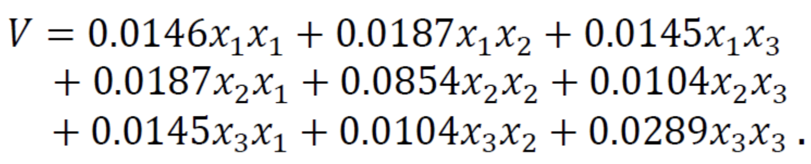
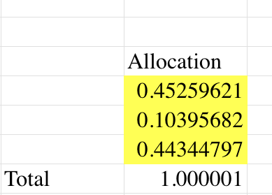

# Portfolio Optimization (Markowitz Model)

An Excel Solver model that builds a minimum-risk portfolio of three stocks while guaranteeing a minimum 10% expected return, using Harry Markowitz's portfolio theory.

## Problem

How should funds be split across three fictional stocks (Alpha, Bravo, Charlie) to achieve at least a 10% expected return with the lowest possible portfolio variance?

## Inputs

| Stock | Expected return | Variance |
|---|---|---|
| Alpha | 6.2% | 0.0146 |
| Bravo | 14.6% | 0.0854 |
| Charlie | 12.8% | 0.0289 |

Covariances: Alpha-Bravo 0.0187, Alpha-Charlie 0.0145, Bravo-Charlie 0.0104.

## Model

Minimize portfolio variance (a non-linear objective):

Subject to:
- x1 + x2 + x3 = 1 (fully invested)
- 0 <= x1, x2, x3 <= 1 (no short selling)
- 0.062x1 + 0.146x2 + 0.128x3 >= 0.10 (minimum 10% expected return)

## Results

| Stock | Allocation |
|---|---|
| Alpha | 45.26% |
| Bravo | 10.40% |
| Charlie | 44.34% |

- **Expected return:** 10.00%
- **Portfolio variance:** 0.0181

Alpha has the lowest variance and gets the largest weight. Charlie's higher return lifts the portfolio to the 10% target at modest risk. Bravo has the highest return but also by far the highest variance, so it gets the smallest share.

## Files

| File | Description |
|---|---|
| `model/portfolio_model.xlsx` | Excel model with covariance matrix, return formulas, and Solver allocation |
| `report/portfolio_optimization_report.pdf` | Full written report |
| `report/portfolio_optimization_report.docx` | Editable version of the report |
| `images/` | Figures used in this README |

## Skills Demonstrated

Portfolio theory, constrained non-linear optimization, Excel Solver, variance/covariance analysis, and communicating quantitative results.
